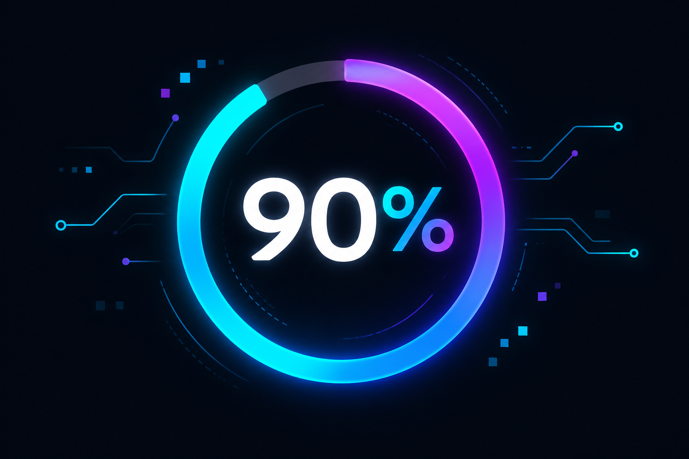

\

&#x20; \
\

\<h1 align="center">
&#x20; Hi, I'm \<a href="[https://github.com/ANDresC-1A](https://github.com/ANDresC-1A)">Andrés Contreras\</a>
&#x20; \
\</h1>

\

&#x20; \
\

\

&#x20; \<i>«Si lo puedes imaginar, lo puedes programar».\</i>
&#x20; \ 
&#x20; \— Alejandro Taboada · Programación ATS\
\

\

&#x20; \
\

## \<picture>\\</picture> Sobre mí

¡Hola! Soy **Andrés Contreras**, estudiante de Ingeniería de Sistemas, apasionado por el desarrollo de software y la tecnología.

Me gusta transformar ideas en proyectos reales, especialmente mediante el desarrollo frontend, el diseño de interfaces y la integración de soluciones tecnológicas.

También me interesa explorar la inteligencia artificial, los videojuegos y la ciberseguridad. Disfruto aprender nuevas herramientas, trabajar en equipo y enfrentar desafíos que me permitan seguir creciendo como desarrollador.

\

&#x20; \
\

\
   \<strong>🎓 Progreso de la carrera de Ingeniería de Sistemas\</strong> \

\
   \ \

## ⚡ SKILLS & TECHNOLOGIES

### 💻 Programming Languages

\

&#x20; \
\

### 🎨 Frontend Development

\

&#x20; \
\

### ⚙️ Backend Development

\

&#x20; \
\

### 🗄️ Databases

\

&#x20; \
\

### 🛠️ Tools & Technologies

\

&#x20; \
\

\

&#x20; \
\

## 🌱 CURRENTLY

- 💻 Improving my skills in software architecture and full-stack development.
- 🤖 Exploring Artificial Intelligence and applications powered by LLMs.
- 🎮 Experimenting with interactive applications and video game development.
- 🔐 Strengthening my knowledge of Cybersecurity and secure development.
- 🧠 Learning new programming paradigms, including Haskell.
- 🚀 Building personal projects and exploring new technologies.

\

&#x20; \
\

## 📊 GITHUB STATISTICS

\

&#x20; \
&#x20; \
\

\

&#x20; \
\

\

&#x20; \
\

## MY CONTRIBUTIONS GRAPH

\
   \ \

\
   \ \

\

&#x20; \
\

## 🤝 CONNECT WITH ME

\

&#x20; \<a href="[https://github.com/ANDresC-1A](https://github.com/ANDresC-1A)">
&#x20;   \
&#x20; \</a>
\

\
   \<i>Thanks for visiting my profile! 🚀\</i> \

\
   \<b>Keep learning. Keep building. Keep creating.\</b> \

